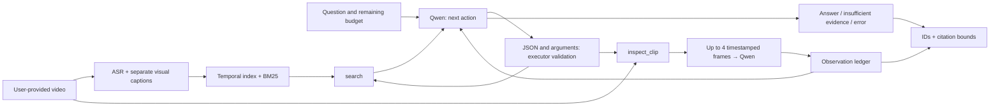

# ClipScout demo walkthrough

The defense should show a working agent, real observations, and measured results with their limitations. Aim for 6–7 minutes; live response time may be longer. Prepare one development question for a live run and one or two **real saved** JSON runs. If no completed result is available, show the status and error rather than a manually prepared "model answer."

Distinguish the two series: `results/test/` is the saved partial v3 pilot with a source snapshot (13 adaptive, 13 retrieval-only, 1 static); `results/corrected/` is the posthoc repeat after the v4 finalizer correction. In the first run, the tool-use system prompt conflicted with the prohibition on further tools during finalization; retrieval-only produced 12/13 format errors. The correction followed inspection of these failures, so the repeat **is not an independent heldout test**, even though questions and references were unchanged. Show final numbers only after verifying the saved artifacts.

## Before starting

From the `ClipScout` folder, after preparing the index and `data/questions.json`:

```powershell
.\run.ps1 serve --index data/indexes/user_video.json --questions data/questions.json --backend local --device cuda --local-files-only --max-new-tokens 384 --image-size 560 --frames-per-clip 4 --max-frames 16 --port 7871
```

Open the [local demo](http://127.0.0.1:7871). Check playback, the backend, and the mode. Qwen3-VL-2B weights are pinned to revision `89644892e4d85e24eaac8bacfd4f463576704203`; CPU/int8 ASR was performed with faster-whisper-base.en. Network access is not required during inference. The first request loads the VLM into the GPU: its time is not directly comparable with later warmed-up requests. The main 560 px size was selected on dev because of the 8 GB GPU; a static trial at 840 px used 7891 of 8192 MiB and took 92.4 s. This is a diagnostic result from before test, not the main study comparison table.

Do not use test questions for further prompt tuning before the defense. The `test` split here names a data subset; the posthoc protocol correction is disclosed above. Reference intervals in this document are for the reviewer and must not enter the model prompt.

The server saves real JSON runs in `runs/demo`. Label each displayed result as current inference, previously saved inference, or a planned question. Do not start a second GPU server alongside an ongoing study.

## 0:00–0:45 — task and data

"The source video was provided by the user: 2575 seconds, almost 43 minutes. We test whether choosing the next clip based on previous observations helps the model when only four tool calls are allowed. The full video is not passed into the prompt."

"This is a pretrained local Qwen3-VL-2B without fine-tuning. We implemented a bounded runtime, search, inspection, logging, and four policies. We prepared 20 questions: 7 dev, 13 test. The assistant created references using ASR and frames; 12 speech references have ASR-supported silver status, and independent human validation is not claimed. This is a single-video study, not a general benchmark."

Point to the [source manifest](../data/source.json). The video is not MIT-licensed along with the reference projects; redistribution permission has not been obtained. Apache-2.0 applies to the code; media is excluded from Git.

## 0:45–1:30 — architecture and budget



"BM25 searches the transcript and previously generated visual captions. This is not a trained visual retriever. `inspect_clip` extracts frames from the source file; the controller chooses the range and the question about the image."

Show the budget examples:

| Example trajectory | Shared budget | Upper frame bound |
|---|---:|---:|
| `search → inspect → inspect → inspect` | 4 calls | 12 |
| `inspect → inspect → inspect → inspect` | 4 calls | 16 |

**This illustrates permitted sampling, not a run result.** Search also consumes a call, so 4 tools do not mean 4 inspections. Errors also consume the limit. An inspection is bounded to 120 seconds, with frames limited to 560 px on the long side before model preprocessing. Four sampled frames do not mean continuously watching two minutes. The overall ceiling is shared, but actual budgets differ across methods.

Stopping generation at the boundary of one JSON object helps separate an action from subsequent text; this is neither grammar-constrained decoding nor semantic verification. The runtime still checks syntax and arguments. A format failure must be shown as a failure rather than manually repaired in the saved trajectory.

## 1:30–3:00 — locate a visual clip

For a live development example, choose `visual_03` if its dev membership is confirmed in the final question file:

> Locate the full-screen Article to Curated Knowledge diagram showing Article + notes, Find the fit, Draft an entry, Human review, and Connected library. Give its approximate time interval.

The assistant annotation suggests approximately **19:58–20:38**. This approximate interval needs verification against the video; it is not a promise of the model's result. If the ID or split changed in the final set, use another published dev example.

After receiving the result, show:

1. The `search` query, returned candidates, and scores. A BM25 score is not a probability of correctness.
2. `inspect_clip`, its arguments, actual sampled timestamps, and the visual observation.
3. The observation ID, final citation, and player seeking to it.

Clicking a citation lets the reviewer see the location in the video. It does not prove that the citation supports the claim. If the agent fails, show empty results, a poor selection, a format error, or abstention. Do not present manually seeking to the correct second as successful agent localization.

A real development preflight is saved in `results/preflight/visual_03.json`: an early generation variant emitted two consecutive JSON objects. This is a diagnostic run from before the main configuration was fixed, not a test result. It can illustrate the need to check action boundaries; assessing the new configuration requires a new saved run.

Another real example is the [visual_01 failure figure](../results/test/figures/visual01_failure.png) from the initial pilot: the source introduction frame with a microphone is on the left, and the actual incorrectly selected inspection frame is on the right. It shows the chain "retrieval → unrelated scene → fabricated VLM observation → rejected answer without a citation." The assistant added the correct frame for analysis; it was not an agent input in this trajectory. This figure belongs to the initial pilot, not the corrected repeat.

## 3:00–4:00 — check a claim against the image

Open the saved adaptive `visual_06` answer from the corrected repeat and the [temporal error figure](../results/corrected/figures/temporal_misattribution.png):

> Which is shown earlier: the full Kanban vs. delegate_task comparison table or the diagram titled How Task Graphs Actually Run? Cite evidence for both.

The model correctly identified event order but claimed that the diagram was visible at 1372.504 s. The actual sampled frame at that moment still shows the table. The diagram appears in a reference frame around 1615 s, added by the assistant for analysis and not supplied to this run. Citation `E001 [1320,1380]` is structurally valid but does not support observation of the second event. This is a partly correct answer with a fabricated timestamp; keyword overlap or event order does not establish evidence support.

"The executor checked that the evidence ID exists and that the citation interval is contained in the observation range. It did not check the semantic truth of every claim or guarantee observation of the whole cited interval. Manual inspection of this demo example does not turn the entire set into an independently validated benchmark."

Do not call this a general evaluation of causal reasoning: the example checks the order of two scenes. Show the saved v4 trajectory and labeled reference context; do not use the question for further model tuning or present this assistant analysis as independent human evaluation.

## 4:00–4:45 — abstention and false confidence

An example of a scoped negative question:

> Using only the visible How Task Graphs Actually Run diagram, what exact dollar cost is assigned to each dispatcher cycle?

In the assistant annotation, the diagram around **26:53–27:03** contains `60s loop` but no dollar cost. This is an assumption about the selected diagram, not proof that cost is never discussed anywhere in the video. Assessing the reliability of this negative reference requires a separate human check.

The expected behavior with insufficient evidence is explicit abstention. If the model fabricates an amount, call it an error; if the backend or JSON parser fails, call it an execution error rather than a correct abstention. Abstaining without finding the diagram differs from verifying that a field is missing. A high abstention count cannot be treated as good quality without considering coverage on answerable questions.

## 4:45–6:15 — actual measurements

Open [REPORT.md](../REPORT.md), `results/corrected/*.predictions.json`, `*.metrics.json`, the manifest, and the assistant's `visual_audit.json`. Show only numbers from saved results. If some modes or questions are incomplete, state the exact completed count. Do not mix the partial v3 pilot with the corrected v4 repeat or move smoke-test values into the comparison table. The assistant audit is neither human nor blind evaluation.

| Mode | Comparison |
|---|---|
| `retrieval-only` | The prepared text index without new frames; captions may have a visual source |
| `static` | Search and fixed inspections of results |
| `uniform` | Fixed windows across the video duration |
| `adaptive` | The next action depends on received observations |

"The model and main query configuration are the same: CUDA, 384 new tokens, 560 px, at most 4 tools / 16 frames. Actual costs differ. This is a capped-budget comparison; a separate matched-frame experiment has not been performed."

Show the lexical answer proxy, temporal IoU/hit, abstention, errors, tools, frames, and latency. Explain denominators: missing/error/abstained answerable examples remain included; onset error is calculated only for geometric matches and reports a separate count. Lexical scores and geometry do not measure full factuality. Bootstrapping 13 test questions does not generalize the result to new videos.

In the evaluator, warmup is one multimodal generation with text and four real frames; its time/tokens are excluded from query latency and saved separately. ASR, captioning, and indexing have separate costs; for captioning recovered after a failure, the last successful portion's time cannot replace total preparation time. If total preprocessing cost is unknown, show `unknown/null`. A posthoc protocol correction is not repeated latency measurement under unchanged conditions. External benchmark data, a blind human rubric, and evidence gate ablation have not been completed here.

Disclose the mixed latency conditions separately: a competing `llama-server` was noticed during `static/visual_02` and then stopped with user permission (2026-10-21 20:12:07 UTC). Its presence and load from the start of the run were not instrumented. The run continued without source changes. The timing table describes these observations; it cannot establish a controlled speed advantage for one policy.

Also show `resume_history.json`: after 40 completed answers, the process was restarted to release GPU memory. The saved `uniform/visual_01` was retained; the unfinished `visual_02` was rerun. The interrupted attempt's cost is unknown, the original manifest is saved separately, and the new process performed another warmup. Study settings did not change, but the sum of final query latencies is not the total cost of the work.

## 6:15–6:45 — artifacts to present

Show one saved real JSON: question, mode, backend/revision, actions, timestamps, observations, citations, usage, and provenance. Then open the [protocol](RESEARCH_PLAN.md), [course alignment](COURSE_ALIGNMENT.md), and [analysis of idea sources](RELATED_WORK.md).

Before the corrected run, 87 tests of software contracts passed. After all results are complete, show reproducible verification and analysis commands from the project root:

```powershell
python -m scripts.verify_study results/corrected --questions data/questions.json --index data/indexes/user_video.json
python -m scripts.summarize_results results/corrected --questions data/questions.json
python -m scripts.plot_results results/corrected
```

Plotting requires the `analysis` extra (`matplotlib==3.10.8`). A new inference run from the README writes to `results/reproduction`, because the CLI refuses to overwrite an existing experiment without a compatible `--resume`. Checking structure and hashes does not verify the factual truth of answers.

Base the conclusion on the actual report: what was measured, where the system fails, and which next experiment will distinguish a retrieval error from a VLM or controller error. Tests confirm implementation contracts; they do not prove the superiority of adaptation or the quality of annotations.
