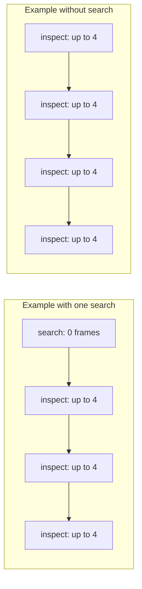

# ClipScout research protocol

## Status and testable claim

**Implemented:** a local pretrained VLM, ASR, visual captions, a BM25 index, `search`/`inspect_clip` tools, a bounded controller loop, four policies, provenance logging, a browser demo, and automatic metrics. Real models were downloaded and verified by hashes; this is not a mock-only implementation.

**Main study:** a pilot comparison on one user-provided video. 20 questions were prepared, 7 dev and 13 test; the assistant created references from an automatic transcript and selected frames. The first v3 run stopped after 13 adaptive, 13 retrieval-only, and one static answer: the shared tool-use system prompt contradicted baseline finalization instructions, accompanied by 12/13 format errors for retrieval-only. Partial results, a source snapshot, and audits are saved in `results/test/`.

The v4 correction separated out a finalizer without available tools and added bounded format retries. All four modes are rerun in `results/corrected/` with unchanged questions and references. **This is a posthoc protocol-corrected repeat, not an independent heldout test.** After inspection of the first run, it must not be presented as an evaluation under a protocol frozen in advance. Exact counts, status, and results are published in [REPORT.md](../REPORT.md), the manifest, and saved JSON files; the existence of a command does not mean an experiment is complete. A new user repeat must write to a fresh folder, such as `results/reproduction/`.

The research question is whether choosing the next clip based on previous observations helps under a small shared budget. **H1:** an adaptive policy may improve answers and localization relative to fixed inspections. This is a hypothesis, not a property guaranteed by the architecture. Retrieval, recognition, and planning errors can eliminate any advantage. **H2**, concerning the effect of the evidence gate on unsupported answers, requires a separate ablation and semantic evaluation; the four main modes do not test it.

## Source data and models

| Item | Frozen specification |
|---|---|
| Video | `Subagents vs Agent Teams 🧠 Hermes Bots Goal Loops Kanban Graphs.mp4`, provided by the user |
| Duration and frame size | 2575.0057667 s, approximately 42:55; 1920×1080, 29.970 FPS |
| Video SHA-256 | `686d883ec68de23543c3c3492ac32c077016201b7a94b1c96d0d3669e32c8efd` |
| Controller, inspector, and answer generation | `Qwen/Qwen3-VL-2B-Instruct`, revision `89644892e4d85e24eaac8bacfd4f463576704203` |
| Main query inference | Local CUDA, BF16, SDPA, greedy decoding (`do_sample=False`), `--max-new-tokens 384 --image-size 560` |
| ASR | `Systran/faster-whisper-base.en`, revision `3d3d5dee26484f91867d81cb899cfcf72b96be6c`, CPU/int8, `en` |
| Annotations | 20 assistant-annotated questions, dev 7 / test 13; actual contents and hash are in the manifest |

The [source manifest](../data/source.json) records video provenance. The [ASR manifest](../data/transcripts/user_video.manifest.json) confirms a completed automatic transcript; a small difference between audio and container duration does not change the source video's timeline. ASR and the VLM can make errors. Preprocessing caption settings are recorded separately from query inference settings; total preparation cost is excluded from query latency.

The [caption manifest](../data/captions/user_video.json.manifest.json) records 43 successful captions / 86 frames, 60-second windows, 192 output tokens, and 560 px. The first 42 windows used endpoint positions; the last was recovered using interior positions after a decoding failure. Full latency/token totals for the first process were not saved and are marked `null`; recovery time is not presented as total preparation cost. Exact reproduction uses the saved captions: the current sampler chooses interior positions in every window and will create a different index.

No MIT license for the video is claimed here: redistribution permission has not been obtained. Apache-2.0 applies to ClipScout code. The source video, weights, and third-party materials are not included in Git.

The main query frame size was reduced from 840 to 560 px during development: a static trial at 840 px took 92.4 s and used 7891 of 8192 MiB of GPU memory. This is an engineering constraint of the 8 GB device and a potential loss of small details, not a measured advantage of lower resolution. Such preflight trials are saved separately. The initial v3 pilot and posthoc v4 repeat use 560 px; the finalizer change does not change these image settings.

## Questions and annotation risks

`data/questions.json` contains `id`, `question`, `category`, `split`, `answerable`, `reference_answers`, `evidence_intervals`, and, where needed, alternative groups in `required_terms`. The prepared file has localization 5, reasoning 5, temporal 5, visual 2, and unanswerable 3. These task categories differ from annotation sources: there are 8 visual-source and 12 speech-source questions in total. The file hash in the manifest links measurements to a specific version.

The assistant prepared the annotations; this is **not a human-validated benchmark**. Speech references have ASR-supported silver status: the audio was not independently listened to. The same ASR error may enter both a reference and the index, so high agreement does not guarantee correct recognition of the original speech. See [ANNOTATION_GUIDE.md](ANNOTATION_GUIDE.md). Selected frames and ASR do not guarantee exhaustive annotation of every event. Unanswerable questions need particular care: limiting the source to a particular diagram or scene is preferable to claiming that information is absent from the entire video. Uncertain reference boundaries and possible reference-answer errors are limitations of the results.

Dev is used to tune format, prompts, and settings. Before test, freeze the question file, index fingerprint, model, and configuration. They must not be changed after inspecting test answers while continuing to describe the result as evaluation of the previous frozen setup. Even a valid dev/test split within one recording does not provide an independent video-level test set: both subsets share a topic, author, and visual style.

In this study, the protocol error was discovered during the initial test run. The `test` split therefore remains the name of the 13-question subset, while v4 results are interpreted as a posthoc repeat. Reference answers were not used for semantic prompt tuning; this does not undo inspection of the failures or restore evaluation independence. Before the repeat, 87 unit tests of software contracts passed; they do not validate semantic correctness.

When answering, the search system and model receive the question and index, not reference answers or gold timestamps. Only public question fields are passed to the browser examples API. The index and captions must not be built using test answers. All four modes use the same prepared index; `retrieval-only` can read visual captions created before the questions, so it cannot automatically be called subtitle-only.

## Budget and sampling diagram

Let `s` be the number of searches, `i` the number of inspections, and `n_j` the number of frames in inspection `j`:

\[
s+i\leq4,\qquad n_j\leq4,\qquad \sum_jn_j\leq16,
\qquad 0<t_{end,j}-t_{start,j}\leq120\text{ s}.
\]

Failed and rejected attempts also consume the shared call budget. Generation calls, format retries, decoded frames, and tool calls are different quantities; the log records them separately. The controller's final answer is not an additional inspection.



**Figure 1. Permitted trajectories, not measured results.** Four tool calls yield at most 16 frames only if all four are inspections. After one search, at most three inspections remain — 12 frames. An invalid call reduces the remaining budget. This explains why a shared ceiling of 4 tools / 16 frames is not a matched-frame comparison. Results must show actual `tool_calls`, `frames_used`, and unique sampled timestamps.

Frames are extracted inside the requested window; their actual timestamps are saved. Four frames from two minutes support only a few observations. The union of inspection windows does not measure continuously viewed duration. Absence of a detail between sparse frames is not established.

## What the evidence gate checks

Observations receive an ID within the run, a source, a requested interval, sampled timestamps, and text. The finalizer checks that a cited ID exists and that the specified interval is inside its associated observation range. Search returns candidates; in `adaptive`/`static`, answers cite the observation ledger, while `retrieval-only` permits a separate ledger of retrieved text.

This is a structural check of provenance and bounds. **It does not prove semantic support for every claim, establish the truth of VLM observations, or require every cited second to match an actually sampled frame.** No separate automatic claim-level visual verification is claimed in the main protocol. Media text is passed as data, but prompt instructions alone do not prove resistance to prompt injection.

Local action generation stops at the boundary of the first complete JSON object. This is structural stopping, not grammar-constrained decoding or a replacement for JSON/argument checks. The change was tested after a development preflight that concatenated two objects. The separate posthoc v4 correction removed the conflict between the tool-use system prompt and finalization without tools; bounded format retries are retained in decisions and usage. Neither structural stopping nor such retries verify an answer's semantic truth.

## Four implemented policies

| Mode | Policy | Interpretation |
|---|---|---|
| `retrieval-only` | One search; an answer from retrieved text without new frames | A baseline for the sufficiency of the prepared text representation |
| `static` | One search followed by fixed inspection of selected results | Compares adaptation with retrieve → inspect without subsequent replanning |
| `uniform` | Four fixed windows near 1/8, 3/8, 5/8, and 7/8 of the duration | Compares against observation independent of question localization |
| `adaptive` | The controller chooses the next tool and arguments from observations | The adaptive policy under study |

The model, query image settings, generation limit, permitted maximum budget, and source video are the same. The inspection prompt is shared; in v4, finalization uses a separate prompt without tools. Control prompts are not fully identical across policies. Methods differ in generation-call counts and the amount of evidence actually obtained. This compares policies under a shared ceiling, **not the isolated causal effect of a single planner line at equal cost**.

The main comparison is `adaptive` against `static` and `uniform`. The difference from `retrieval-only` includes the effect of new visual observations. Uniform windows respect the 120-second maximum: one call cannot secretly sample frames across the entire hour. The report publishes calls, frames, and latency alongside quality.

## Implemented metrics

- **Token F1 and EM:** Unicode word tokens, casefolding, and punctuation-boundary removal; the best score across acceptable answers is used. This measures lexical similarity. `lexical_correctness_proxy` requires a match from every `required_terms` group when specified, otherwise EM. The presence of words does not establish correct reasoning or causality.
- **Task success proxy:** the lexical proxy for answerable questions; explicit `insufficient_evidence` for unanswerable questions. An execution error is not a correct abstention.
- **Temporal IoU:** optimal one-to-one matching of citation intervals and reference intervals maximizing total IoU; the sum is normalized by the number of reference intervals. Missing components receive zero. Wide windows lose IoU, duplicate geometry is removed, and one citation interval cannot cover two required components.
- **Hit / evidence recall at IoU ≥0.3 and ≥0.5:** hit means at least one component; recall is the fraction of components matched one-to-one. Multi-hop success requires all mandatory intervals. These metrics are not interchangeable.
- **Independent retrieval:** original question → BM25 top-5; gold is used only for scoring. This is a separate search run, not evaluation of agent-selected queries from their traces.
- **Onset error:** mean absolute start-time deviation for geometrically matched intervals with positive overlap. This is a conditional metric; the number of evaluated questions and matched intervals is reported separately. Missing answers are not assigned zero error. A timestamp-only pointing score is not implemented in the current evaluator.
- **Abstention:** answerable coverage, unanswerable abstention accuracy, and selective risk based on the lexical proxy. The latter is not a measured semantic risk calibration.
- **Cost and budget:** tools, frames, latency, tokens/model calls in original traces, and limit violations. Trace length prevents undercounting tool calls; failed calls are included. The JSON summary and summary script present aggregates differently; scores are taken from saved files.

All answerable examples for the relevant task remain in denominators, including missing/error/abstained predictions. Grounding includes answerable questions with reference intervals; unanswerable questions are evaluated separately and in the overall task proxy. Specific denominators are saved in JSON. Onset and selective risk use explicitly stated conditional subsets. Successful trajectories must not be selectively retained.

Bootstrap CIs use 1000 resamples, seed 42, and percentile intervals for means over the available questions. This is exploratory uncertainty on a small sample from one video; the interval does not reflect annotation uncertainty, generalization to new videos, or variation from repeated training.

## Execution and audit

For a new reproduction on the same subset after preparing the index and questions, use a fresh folder:

```powershell
.\run.ps1 evaluate --index data/indexes/user_video.json --questions data/questions.json --split test --modes adaptive retrieval-only static uniform --output results/reproduction --backend local --device cuda --local-files-only --max-new-tokens 384 --image-size 560 --frames-per-clip 4 --max-frames 16
```

Before question timers start, the evaluator performs one multimodal warmup generation with a text instruction and four real frames. Model loading, warmup, and warmup frame/token usage are recorded separately; ASR/captioning/indexing are also excluded from query latency. Warmup is neither free nor hidden question evidence. The inspection cache is disabled in this command. One run per question does not measure a stable latency distribution: median/p95 across different questions, if shown, describe different workloads rather than repeatability of the same query.

During the corrected repeat, a competing `llama-server` was noticed during `static/visual_02` and stopped with user permission at **2026-10-21 20:12:07 UTC**. Study source code and settings did not change. The process's presence and load from the start of the run were not instrumented; adaptive and retrieval-only finished before it stopped, but continuous contention across all their questions has not been established. Latency therefore records observed time under uncontrolled conditions rather than proving relative mode speed. Such a conclusion requires a separate repeat without competing load.

After 40 completed answers, the process was restarted with `--resume` to release GPU memory. The saved `uniform/visual_01` was not replaced; the interrupted `uniform/visual_02` was rerun. Its partial time/tokens are unknown and excluded from the completed answer's per-question latency. The first manifest is saved as `manifest.initial_process.json`, with restart history in `resume_history.json`. The new process repeated warmup; total actual cost includes both processes and the unknown interruption cost. Code, model, index, questions, and query settings did not change on resume.

The manifest saves question IDs, the question-file hash, index fingerprint, backend, prompt version, and main settings. Per-mode predictions contain original answers, evidence, and trajectories. A complete test run requires 13 entries per mode; missing/error cases are not excluded. A partial run must be called partial and report its completed count rather than treating a missing file as zero-valued "success." A repeat with a new configuration gets a new output directory.

The CLI refuses to overwrite an existing experiment without `--resume`; this flag only continues a compatible manifest with the same source code and runtime. After all four modes of the corrected repeat are complete, run the following from the `ClipScout` root:

```powershell
python -m scripts.verify_study results/corrected --questions data/questions.json --index data/indexes/user_video.json
python -m scripts.summarize_results results/corrected --questions data/questions.json
python -m scripts.plot_results results/corrected
```

Use the project environment's Python; the `analysis` extra includes `matplotlib==3.10.8` for plotting. For a new reproduction, substitute `results/reproduction`. The verifier checks artifacts and structure, not semantics. The original incomplete pilot and its source snapshot remain in `results/test/`; they must not be mixed with v4 results in one comparison table.

## Future experiments — not yet performed

1. Independent human annotation and a blind manual 0/1/2 rubric for reasoning/claim support, with disagreement analysis.
2. A matched-frame experiment with equal actual frame counts, such as 12, and separate control of model calls. Setting `--max-frames 12` alone does not ensure equal actual costs.
3. At least three latency repeats of the same questions after warmup; separate cold/warm-cache conditions and GPU memory measurements.
4. Disabling the evidence gate, visual questions without subtitles, and timestamp corruption as diagnostic ablations. These need separate flags/variants and conclusions rather than relabeling the four baseline modes.
5. External videos and independent benchmark splits, plus reevaluation with another VLM. LongTVQA/LongTVQA+ are considered sources of ideas here, not completed benchmarks.

Even a positive main result supports only a limited claim about this video, these questions, this model, and this budget. A negative result is useful when retrieval failures, visual observations, format errors, costs, and denominators are published.
